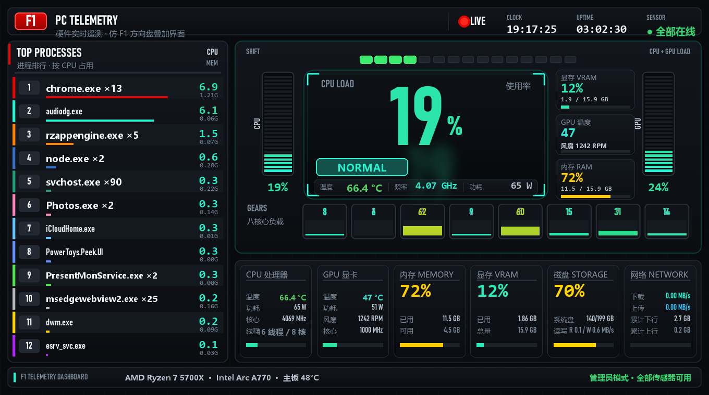

# F1 遥测仪表盘 · PC Telemetry Dashboard

一个仿 **F1 Halo 方向盘车载遥测叠加界面** 的 Windows 硬件监控小工具。
界面完全按 F1 转播的车载图形重绘：左侧计时塔、中央方向盘显示模块、换挡灯带、
转速条、以及包围车手的 Halo 遥测卡片。



---

## 1. 能监控什么

| 项目 | 数据 | 来源 |
| --- | --- | --- |
| **CPU** | 总占用 / 16 个逻辑核心逐个占用 / 核心温度 (Tctl-Tdie) / 封装功耗 / 实时频率 / 基频 / 核心电压 | LibreHardwareMonitor + psutil |
| **GPU** | 核心温度 / 占用率 / 渲染与媒体引擎占用 / 功耗 / 风扇转速 / 核心与显存频率 | LibreHardwareMonitor（Intel Arc / NVIDIA / AMD 通用） |
| **内存** | 已用 / 可用 / 总量 / 占用率 / 虚拟内存 | psutil |
| **显存** | 已用 / 总量 / 占用率 | LibreHardwareMonitor（缺失时回退注册表 + Windows 性能计数器） |
| **温度** | CPU 核心、主板 CPU、System、VRM MOS、PCH、硬盘（每块 NVMe / SATA） | LibreHardwareMonitor |
| **散热** | CPU 风扇、系统风扇、水泵、显卡风扇（RPM） | LibreHardwareMonitor |
| **磁盘** | 每个分区容量占用、读写速率、SSD 温度 | psutil + LibreHardwareMonitor |
| **网络** | 实时上下行速率、累计流量 | psutil |
| **进程** | 按 CPU 占用排序的前 12 名（同名多进程自动合并） | Windows PDH 性能计数器 |

> **GPU 部分不需要管理员权限**（Intel Arc A770 实测温度、功耗、风扇、显存全部可读）。
> **CPU 核心温度需要管理员权限** —— 它要通过内核驱动读 MSR 寄存器。
> 本机已安装 PawnIO 驱动，因此只要以管理员身份启动就能拿到 CPU 温度、主板风扇与硬盘温度。

---

## 2. 两种形态

程序有两种界面，**默认启动的是悬浮小窗**，右键菜单随时切换。

### 2.1 悬浮小窗（默认）

无边框、背景透明、永远置顶，像游戏 OSD 一样浮在桌面上，画面任意位置都能拖动。
外观是照着 F1 方向盘那块**圆形**曲面屏复刻的：

```
                     ╭───────────────╮
   ▤▤▤▤  ┌─────────┤  C P U L O A D ├─────────┐  ▤▤▤▤
   ▤▤▤▤  │ M E M O │       27       │  V R A M │  ▤▤▤▤
   ▤▤▤▤  │ R Y     │  ╭ F R E Q ─╮  │          │  ▤▤▤▤
   ▤▤▤▤  │         │  ╰ N O R M A L ╯ │          │  ▤▤▤▤
   ▤▤▤▤  │         │       22       │          │  ▤▤▤▤
         └─────────┤  G P U L O A D ├─────────┘
                    ╰───────────────╯
                      ▓▓▓▓░░▶ 64.0 °C
```

几何上分三层，都是绕同一个圆心展开的：

| 结构 | 说明 |
| --- | --- |
| **中央正圆** | 整块圆形屏面，外围一圈细亮环，屏内有竖向拉丝纹理和上亮下暗的冷色渐变 |
| **环形扇区内圈** | 两侧各一块**蓝色标签牌**（±30°），竖排深蓝英文 MEMORY / VRAM |
| **环形扇区外圈** | 两侧各一条**分格 LED 表**（±19°），横向分格，点亮时是绿色 |

| 位置 | 显示内容 |
| --- | --- |
| 圆内上方大号白字 | **CPU 负载** |
| 圆内下方大号白字 | **GPU 负载** |
| 暗灰状态条（BOOST 位，两侧带斜格栅） | CPU 实时频率 |
| 高亮发光条（OVERTAKE 位） | CPU 温度状态：COOL / NORMAL / WARM / HOT |
| 左侧蓝牌 + LED 表 | **内存**占用 |
| 右侧蓝牌 + LED 表 | **显存**占用 |
| 底部蓝色电池（+ 暗色副格） | **CPU 温度**（30~95°C 映射成电量，颜色随温度变化） |

> 读数平时是白色（跟实车一样），只有负载 ≥78% 转琥珀、≥92% 转红；
> LED 表平时是绿色，≥80% 转琥珀、≥92% 转红 —— 既能一眼看出异常，
> 又不会破坏实车那套「黑 + 白 + 青 + 绿」的配色。

**右键菜单**：显示全部信息 · 设置… · 窗口置顶 · 鼠标穿透 · 打开程序目录 · 关闭悬浮窗

### 2.2 完整仪表盘

点右键菜单的「显示全部信息」，或按 `H` / 双击画面，切换到完整面板：

```
┌ 顶栏 ────────────────────────────────────────────────────────────────┐
│ F1  PC TELEMETRY            ● LIVE   CLOCK  UPTIME   ● 传感器状态    │
├ 计时塔 ────────┬ 方向盘中央显示模块 ────────────────────────────────┤
│ P1  chrome     │  ▮▮▮▮▮▮▮ 换挡灯带（CPU/GPU 负载）                  │
│ P2  audiodg    │  CPU竖条 │  CPU LOAD 大号读数 │ GPU竖条             │
│ ...            │          │ 温度/频率/功耗信息条 │ 显存·GPU温度·内存 │
│ P12            │  ① ② ③ ④ ⑤ ⑥ ⑦ ⑧  ← 八核心负载（GEARS）         │
├────────────────┴──────────────────────────────────────────────────────┤
│ CPU 处理器 │ GPU 显卡 │ 内存 MEMORY │ 显存 VRAM │ 磁盘 │ 网络        │
├ 底栏：硬件型号 · 主板温度 · 权限状态 ─────────────────────────────────┤
└───────────────────────────────────────────────────────────────────────┘
```

界面元素与 F1 转播图形的对应关系：

| F1 原版 | 本仪表盘 |
| --- | --- |
| 计时塔排行榜 P1–P12 | 进程 CPU 占用排行（车队色条） |
| 中央大号车速 `296 KM/H` | CPU 总占用率（数值越大颜色越热） |
| `BOOST` / `OVRTAKE` 药丸 | CPU 温度状态（COOL / NORMAL / WARM / HOT / 待解锁） |
| 中央底部信息条 | CPU 温度 / 频率 / 功耗 |
| `RECHARGE` 竖条 | CPU 负载竖条 |
| `DEPLOY` 竖条 | GPU 负载竖条 |
| `ACTIVE AERO` 面板 | 显存 / GPU 温度 / 内存卡片 |
| `GEARS 1–8` 档位灯 | 八核心逐个负载 |
| 换挡指示灯带 | CPU 与 GPU 中较高的负载 |

---

## 3. 快速开始

### 3.1 安装依赖（只需一次）

双击 **`安装依赖.bat`**，或手动执行：

```bat
python -m pip install -r requirements.txt
```

需要 **Python 3.10+**（自带 tkinter）。本机已验证 Python 3.12。

### 3.2 启动

| 双击 | 效果 |
| --- | --- |
| **`启动仪表盘.bat`** | 弹一次 UAC 后以管理员身份启动 —— **CPU 温度等全部传感器可用**。若在 UAC 里点“否”，会自动降级为普通权限启动，界面照常工作。 |
| **`以普通权限启动.bat`** | 不弹 UAC。GPU 温度/显存/占用/内存全部可用，CPU 核心温度显示为“待解锁”。 |
| **`停止仪表盘.bat`** | 结束仪表盘与传感器桥接器进程。 |

> 启动脚本会用一个隐藏的 PowerShell 进程陪跑（`-Wait`）。这是必要的：
> 提权后的进程树一旦父进程退出，子进程有可能被系统连带清理，表现为仪表盘“启动后自己闪退”。
> 保留一个陪跑父进程就彻底避免了这个问题；关闭仪表盘窗口后它会自动退出。
> 想省掉这个进程，就用 `以普通权限启动.bat`（代价是没有 CPU 温度）。

### 3.3 快捷键

| 按键 | 功能 |
| --- | --- |
| 鼠标右键 | 弹出菜单：**显示全部信息 / 收起为悬浮小窗 · 设置… · 窗口置顶 · 鼠标穿透 · 打开程序目录 · 关闭悬浮窗** |
| `H` / `F11` / 双击画面 | 在 **悬浮小窗** 与 **完整仪表盘** 之间切换 |
| 拖动画面 | 移动窗口（两种形态都可拖动；悬浮小窗没有标题栏，只能这样拖） |
| `Esc` | 悬浮小窗形态下 = 退出程序；完整形态下 = 收起飞回悬浮小窗 |
| `T` | 窗口置顶开关 |
| `P` | 完整面板里显示 / 隐藏进程排行 |
| `Ctrl + Alt + L` | 鼠标穿透开关（开启后点击会穿透到下层窗口；因为画面已不可点击，只能用这个全局快捷键切回来） |
| `S` | 把当前设置写回 `config.json` |
| `R` | 恢复默认尺寸 |

**设置对话框**（右键 → 设置…）：界面缩放、不透明度、刷新间隔、窗口置顶、
完整面板是否显示进程排行、**开机自动启动**（会在「启动」文件夹里放一个 `.cmd`，不需要管理员权限）。

---

## 4. 配置文件 `config.json`

```jsonc
{
  "mode": "mini",            // mini = 无边框悬浮小窗（默认）；full = 完整仪表盘
  "scale": 1.0,              // 整体缩放，屏幕小可设 0.75
  "always_on_top": true,     // 窗口置顶
  "opacity": 0.98,           // 整体不透明度 0.3 ~ 1.0
  "ui_ms": 500,              // 界面刷新间隔（毫秒）
  "show_processes": true,    // 完整面板是否显示左侧进程排行
  "sensors": {
    "poll_ms": 1000,         // 传感器采样间隔
    "process_ms": 2000,      // 无 PDH 时进程采样的降频周期
    "top_processes": 12,     // 计时塔显示多少行
    "enable_lhm": true       // 是否启用 LibreHardwareMonitor 桥接器
  }
}
```

> 小技巧：想让悬浮小窗一直浮在游戏画面上，再按一次 `Ctrl+Alt+L` 打开鼠标穿透即可。

---

## 5. 数据是怎么来的

两条互相补充的采集路径：

### 5.1 `SensorBridge.exe` —— 直连 LibreHardwareMonitor

`vendor/bridge/SensorBridge.cs` 是一个很小的 C# 控制台程序，链接
`LibreHardwareMonitorLib.dll`，把传感器读数以行协议从 stdout 吐出来：

```
H|[{...硬件与传感器清单...}]      # 启动时输出一次
D|[[硬件号, 传感器号, 数值], ...]  # 之后每个周期输出一行
E|错误信息                        # 走 stderr，不污染数据流
```

Python 侧 `src/f1dash/sensors.py` 里的 `LhmBridge` 启动这个子进程并逐行解析。
相比直接用 LHM 的图形界面，这样做的好处是：**不弹窗、不占托盘、低占用，而且进程崩溃后会自动重启**。

这个桥接器就是本机编译出来的，想重新编译执行：

```bat
"C:\Windows\Microsoft.NET\Framework64\v4.0.30319\csc.exe" ^
  /nologo /platform:x64 /target:exe /optimize+ ^
  /out:vendor\bridge\SensorBridge.exe ^
  /r:vendor\lhm\LibreHardwareMonitorLib.dll ^
  /r:vendor\lhm\HidSharp.dll ^
  vendor\bridge\SensorBridge.cs
```

### 5.2 `psutil` + Windows PDH

* CPU / 内存 / 磁盘 / 网络 的秒级统计、以及系统运行时长来自 psutil。
* **进程排行走 Windows 性能计数器（PDH）**：`\Process(*)\% Processor Time` 与
  `\Process(*)\Working Set - Private` 一次查询就能拿到全部 300+ 进程，
  耗时约 **7 毫秒**；而 psutil 逐个进程读要 **1 秒以上**（每个进程都要 OpenProcess）。
  实现见 `src/f1dash/pdh.py`（纯 ctypes，无第三方依赖）。
* PDH 同时也是显存/GPU 占用的**兜底数据源**：万一 LibreHardwareMonitor 认不出显卡，
  仪表盘仍能显示 GPU 占用与显存用量（总量从注册表 `HardwareInformation.qwMemorySize` 读取）。

---

## 6. 目录结构

```
D:\yibiaopan\
├── 启动仪表盘.bat            以管理员身份启动（推荐）
├── 以普通权限启动.bat        不弹 UAC 启动
├── 停止仪表盘.bat            结束进程
├── 安装依赖.bat              一键 pip install
├── run.py                    入口（支持 --selftest / --dump 排查）
├── config.json               用户配置
├── requirements.txt
├── src\f1dash\
│   ├── theme.py              配色、字体（Bahnschrift 可变字体）、绘图工具
│   ├── sensors.py            采集层：桥接器 + psutil 融合
│   ├── pdh.py                Windows 性能计数器封装（进程排行 / GPU 兜底）
│   ├── mini.py               悬浮小窗渲染（F1 方向盘近景，弧形灯条 + 温度电池）
│   ├── render.py             完整仪表盘渲染（F1 Halo 转播图形，Pillow 逐帧绘制）
│   └── app.py                Tk 窗口、两种形态切换、右键菜单、设置对话框、鼠标穿透
├── vendor\
│   ├── lhm\                  LibreHardwareMonitor 0.9.6 运行库
│   ├── bridge\               SensorBridge.cs / SensorBridge.exe
│   └── pawnio\               PawnIO 驱动安装包（已安装，可保留作备份）
└── logs\                     运行日志、PID 文件、预览图
```

---

## 7. 排查问题

**命令行自检**（不开窗口，打印一次完整采集结果）：

```bat
python run.py --selftest
```

**打印全部可用传感器原始清单**：

```bat
python run.py --dump
```

**看运行日志**：`logs\f1dash.log`。启动、退出、刷新异常都会写进去，
退出时还会附上调用栈 —— 界面莫名消失时先看这里。日志超过 2 MB 会自动轮转成 `f1dash.log.1`。

**常见情况**

| 现象 | 原因与处理 |
| --- | --- |
| CPU 温度显示 `—`，右上角 `○ 部分受限` | 当前是普通权限。用 `启动仪表盘.bat` 以管理员身份重启即可。 |
| 右上角 `× 已离线` | `SensorBridge.exe` 没能启动。确认 `vendor\lhm\` 目录完整，然后跑 `python run.py --dump` 看报错。 |
| 显卡那几格是 `—` | 该显卡不被 LibreHardwareMonitor 支持；此时占用率与显存会自动走 PDH 兜底，温度/功耗则确实拿不到。 |
| 界面太大 / 太小 | 改 `config.json` 里的 `"scale"`（例如 `0.8`），或按 `R` 恢复。 |
| 想开机自启 | `Win + R` 输入 `shell:startup`，把 `启动仪表盘.bat` 的快捷方式丢进去。 |
| 全局热键 `Ctrl+Alt+L` 没反应 | 被别的程序占用了，日志里会有提示；用右键菜单里的“鼠标穿透”代替。 |

**性能开销**：实测本体 **0.4% 左右 CPU**（16 线程机器）、常驻内存 ~72 MB；
`SensorBridge.exe` 常驻 ~75 MB、约 0.4% CPU。
悬浮小窗每帧约 20 ms（内部 2 倍超采样后缩放，所以圆角和斜条没有锯齿），
完整面板每帧约 12 ms，默认 500 ms 刷新一次。
进程排行走 PDH，一次查询约 7 ms —— 相比之下用 psutil 逐个进程读要 1 秒以上。

---

## 8. 第三方组件

* [LibreHardwareMonitor](https://github.com/LibreHardwareMonitor/LibreHardwareMonitor)（MPL-2.0）—— 传感器读取库，见 `vendor/lhm/`
* [PawnIO](https://pawnio.eu/)（开源签名内核驱动）—— 提供 MSR / SMBus 访问；已安装在本机
* [psutil](https://github.com/giampaolo/psutil)（BSD-3）—— 系统统计
* [Pillow](https://python-pillow.org/)（MIT-CMU）—— 界面绘制

字体使用 Windows 自带的 **Bahnschrift**（F1 官方转播图形也是这类 DIN 风格窄体字），中文回退 **微软雅黑**。
